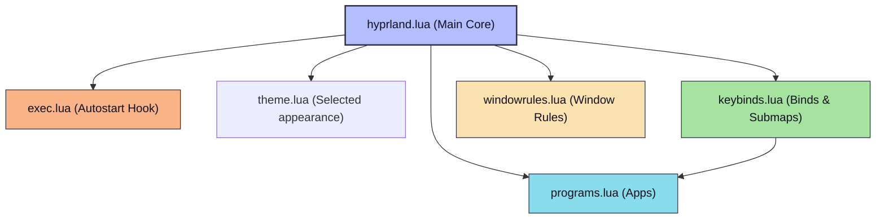

# Architecture Documentation

This document describes the architectural layout, configuration hierarchy, startup sequence, script interaction pattern, and dependencies of the `hypr-dots` desktop environment.

---

## Configuration Hierarchy

The configurations in this repository are designed to be modular. Instead of a single monolithic configuration, settings are split into specialized files and composed at runtime.

### Hyprland Composition
At startup, Hyprland reads the main configuration file `hyprland.lua` which defines core hardware settings, variables, and styling. It requires modular Lua components cleanly via `require()`:



> [!NOTE]
> `programs.lua` exports default user applications (`terminal`, `fileManager`, `menu`) as a standard Lua table required by `keybinds.lua`. Autostart commands in `exec.lua` are attached to the `hyprland.start` lifecycle hook. Legacy `.conf` files are archived in `config/hypr/legacy/`.

### Waybar Composition
Waybar uses a two-level structure for both its configurations (JSON) and layouts (CSS):

1. **Configuration JSON**. The project default or saved edge selects a horizontal or vertical profile. Each profile draws on the same module fragments. The including profile wins for each field it overrides. Groups inherit the bar orientation, so shared module ordering works on every edge.
   - Includes layout fragments from `modules/left.jsonc` (workspaces, active window title).
   - Loads the standalone clock and its calendar from `modules/center.jsonc`.
   - Loads system modules and the Settings gear’s hover drawer from `modules/right.jsonc`.
   - Loads module definitions from `modules/system.jsonc` (built-in CPU, memory, battery, etc.) and `modules/custom.jsonc` (custom scripts).

2. **Styling CSS (`style.css`)**:
   - Imports the selected `theme.css` palette and typography, then `styles/base.css` for global rules.
   - Imports `styles/modules.css` (individual module styles, colors, and hover effects).
   - Imports `styles/states.css` (state-dependent styles like low battery or muted audio, plus blink animations).
   - Imports `styles/workspaces.css` (workspace button styling and layout).

---

## Startup Sequence

Applications and services are launched sequentially via the `hyprland.start` event hook in [exec.lua](../config/hypr/exec.lua). The startup sequence is ordered as follows:

| Order | Command / Service | Description | Why It's Needed |
| :--- | :--- | :--- | :--- |
| **1** | `nm-applet` | NetworkManager Applet | Provides the system tray network indicator and network selector. |
| **2** | `blueman-applet` | Bluetooth Manager Applet | Provides the system tray Bluetooth controls and connection status. |
| **3** | `waybar-position.sh --start` | Status Bar | Renders the primary user interface bar (workspaces, system status, clock). |
| **4** | `desktop_controls.py login` | Night light | Starts hyprsunset when enabled at login. The default is enabled. |
| **5** | `/usr/lib/polkit-kde-authentication-agent-1` | Polkit Authentication Agent | Handles graphical permission escalation dialogs (e.g., when launching package managers). |
| **6** | `wl-paste --type text --watch cliphist store` | Clipboard Manager (Text) | Monitors clipboard copy actions and stores text snippets in `cliphist`. |
| **7** | `wl-paste --type image --watch cliphist store` | Clipboard Manager (Images) | Monitors clipboard copy actions and stores image captures in `cliphist`. |
| **8** | `hypridle` | Idle Management | Runs in the background to lock, turn off monitors, or suspend after inactivity. |
| **9** | `wpaperd` | Wallpaper Daemon | Starts the active wallpaper rotation daemon. (Note: `hyprpaper` is disabled). |

---

## Theme System

The default Mocha palette and each additional theme live in `themes/<id>/theme.toml`. Shared defaults define typography, opacity and borders. A switch validates the manifest, renders small native adapters, copies theme artwork and atomically selects the resulting build. Applications read shared behavior through native includes or links. The installer gives each application a stable directory so relative Waybar imports continue working across switches. See the [theme guide](theming.md) and [decision 0012](decisions/0012-desktop-themes.md).

## Desktop settings

Wofi launches the GTK4 settings window through an XDG desktop entry. The visible page refreshes every two seconds and after each change. Theme selection and bar position use their existing commands and files. Audio, panel brightness, wallpaper rotation, notification mode and the running night light schedule use their native controls. The separate login preference lives in `${XDG_CONFIG_HOME:-$HOME/.config}/hypr-dots/preferences.json`. [State ownership and extension guidelines](decisions/0013-desktop-settings.md)

During a screen recording the application holds a reference to its own recorder process and stays available after the window closes. Reopening Settings exposes the stop control. The save folder uses the shared preferences file. [Recording lifecycle](decisions/0014-screen-recording.md)

Settings acquires an idle inhibitor from systemd-logind. The application owns the file descriptor and stays alive while the switch is on. Closing the window preserves the inhibitor. Turning it off or exiting the application releases it. Hypridle observes logind idle inhibitors with the shipped configuration.

---

## Component Dependencies

The diagram below illustrates how components interact and rely on each other:

```
+--------------------------------------------------------+
|                      User Input                        |
+---------------------------+----------------------------+
                            |
                            v
+---------------------------+----------------------------+
|                       Hyprland                         |
+-----+--------------+--------------+--------------+-----+
      |              |              |              |
      v              v              v              v
+-----+----+   +-----+----+   +-----+----+   +-----+----+
| Keybinds |   |  Exec    |   | Rules    |   |  Idle    |
+-----+----+   +-----+----+   +-----+----+   +-----+----+
      |              |                             |
      |              | +---------------------------+
      |              | |
      v              v v
+-----+--------------+-+--+
| Scripts / System Utils  | <---+ (Signals: RTMIN+N)
+-----+--------------+----+     |
      |              |          |
      v              v          |
+-----+----+   +-----+----+     |
|   Mako   |   |  Waybar  | ----+
+----------+   +----------+
```

---

## Shared Resources

- **Fonts**: `JetBrainsMono Nerd Font` must be installed. Waybar and Hyprlock request the Nerd Font family. Foot and Kitty request JetBrains Mono and use fontconfig fallback when needed.
- **Wallpapers**: Mocha reads `~/Pictures/wallpapers/`. Other manifests can supply a rotation gallery and lock image.
- **Waybar position**: The session launcher uses `${XDG_STATE_HOME:-$HOME/.local/state}/hypr-dots/waybar-position.jsonc`. Edge changes replace this file atomically.
- **Live Wallpaper**: The toggle live wallpaper script expects a video file located at `~/Pictures/live-wallpapers/stone-bridge.mp4`.
- **Screenshots**: Screens taken using print key combinations are saved to `~/Pictures/`.

---

## Runtime Assumptions

1. **Hardware**: The named Samsung panel uses 10-bit SDR. Other monitors use their preferred mode with automatic scale and placement.
2. **OS**: Arch Linux with systemd, using `pacman` as the package manager.
3. **Audio**: PipeWire/WirePlumber, using `wpctl` command bindings.
4. **Network**: NetworkManager backend, with `nm-applet` tray manager.
5. **Bluetooth**: BlueZ stack, with `blueman-applet` GUI.
6. **Daemons**: The optional mouse submap requires the `ydotool` user service when enabled.
